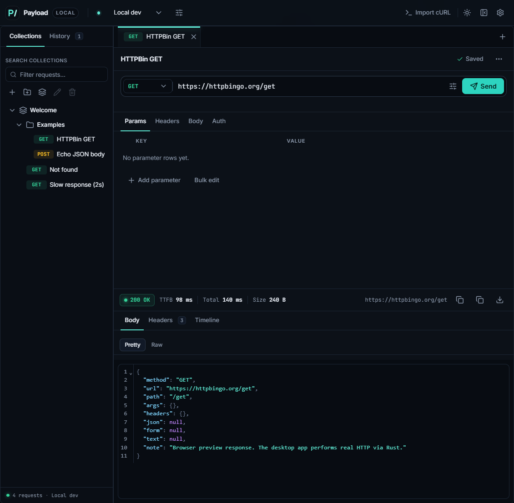
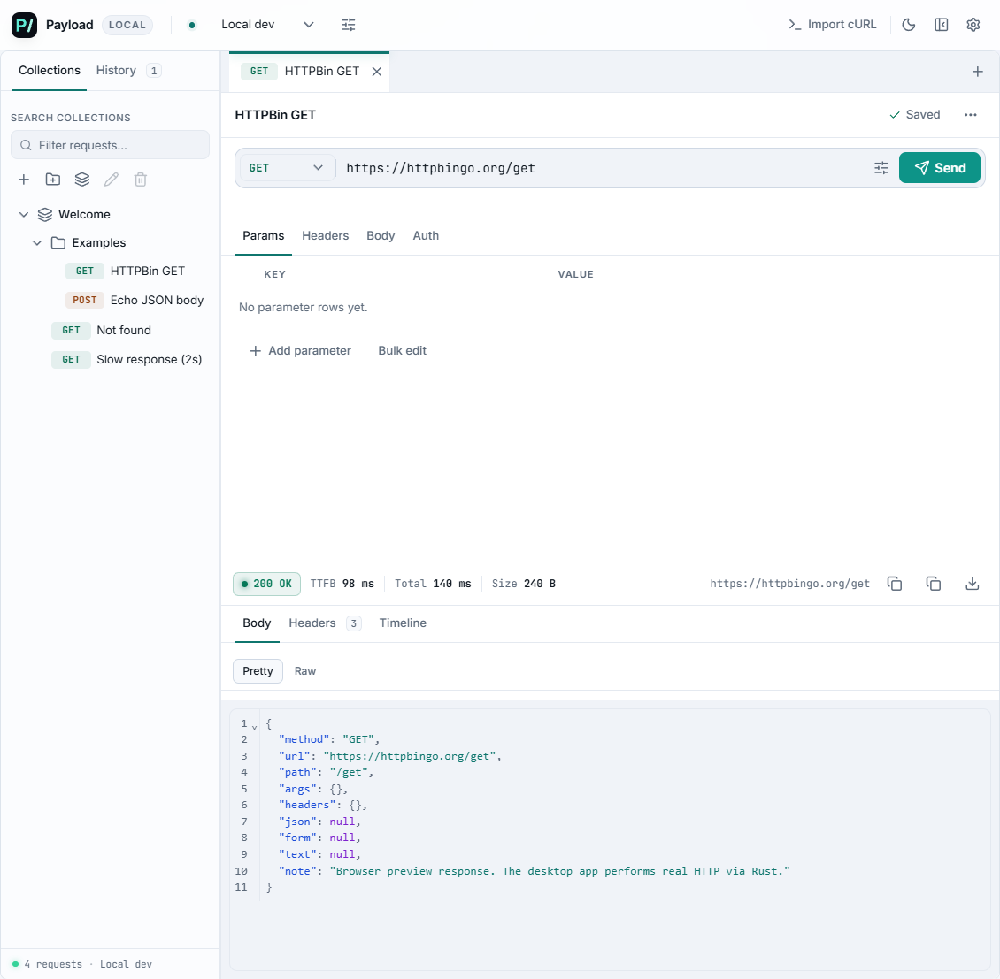

# Payload

A local-first desktop API client for building, sending, and inspecting HTTP requests.

Payload runs entirely on your machine. Requests are executed by a Rust backend, cookies live in an in-memory session jar, and collections, environments, and history are stored in a local workspace file — no account or cloud sync.

<p align="center">
  
</p>

## Features

- **Collections and folders** — organize saved requests in a tree with search, rename, and context menus.
- **Request builder** — methods, query params, headers, JSON/text/form bodies, and Bearer, Basic, or API key auth.
- **Response inspector** — status, TTFB and total time, size, pretty/raw body, headers, and timing timeline.
- **Environments and variables** — switch environments and use `{{variable}}` substitution across requests.
- **cURL import and export** — paste a cURL command to create a request, or copy any request as cURL.
- **History** — every sent request with status, timing, and size.
- **Tabs** — keep multiple requests open, with dirty-state indicators.
- **Appearance** — light, dark, or system theme with six accent colors.
- **Request options** — timeout, redirect following, TLS verification, and proxy support.
- **Workspace safety** — atomic saves with backup recovery for your local data.

<details>
<summary>Light theme</summary>

<p align="center">
  
</p>

</details>

## Download

Prebuilt installers are attached to [GitHub Releases](../../releases/latest):

| Platform | Packages |
| --- | --- |
| Windows | `.msi`, NSIS `.exe` |
| macOS | `.dmg` (Apple Silicon and Intel) |
| Linux | `.AppImage`, `.deb` |

Builds are currently unsigned, so macOS Gatekeeper and Windows SmartScreen may warn on first launch.

## Development

Requirements:

- [Bun](https://bun.sh/)
- Rust toolchain and the [Tauri 2 system dependencies](https://tauri.app/start/prerequisites/) for your platform

```sh
bun install
bun run tauri dev
```

For frontend-only work, `bun run dev` serves the UI at http://localhost:1420. Native HTTP, cookies, and persistence require the Tauri app.

## Verification

```sh
bun run test       # Vitest and Testing Library
bun run build      # TypeScript check and production frontend build
cargo check --manifest-path src-tauri/Cargo.toml
```

## Releasing

The [Release workflow](.github/workflows/release.yml) builds Windows, macOS (arm64 and x64), and Linux bundles on tag pushes and opens a draft GitHub release. Tag a version that matches `package.json` and `src-tauri/tauri.conf.json`:

```sh
git tag v0.1.0
git push origin v0.1.0
```

## Project structure

- `src/`: React UI, Zustand store, request utilities, and tests.
- `src/store/`: state, persistence, and storage migrations.
- `src/lib/`: request building, API integration, cURL, and variables.
- `src-tauri/src/`: Rust HTTP execution, cookies, cancellation, and workspace storage.
- `scripts/mock-server.mjs`: local mock API server for manual testing.
- `AGENTS.md`: repository guidance for coding agents.

## License

[MIT](LICENSE) © 2026 ali abdy
